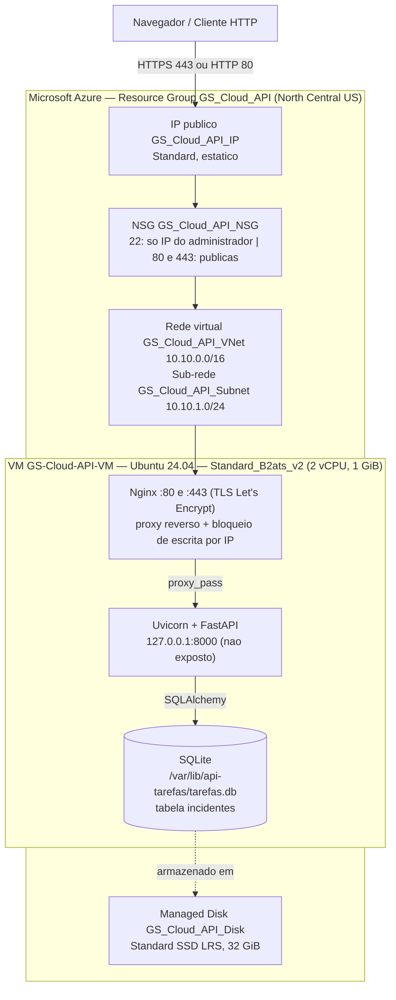

# CyberIncident API

[](https://github.com/brenoaveiro/api-tarefas-fastapi-sqlite-azure/actions/workflows/ci.yml)

**Plataforma de Gerenciamento de Incidentes de Segurança Cibernética**

API REST acadêmica, em Python/FastAPI com SQLite, que simula o registro de incidentes de uma central de operações de segurança (SOC). Hospedada em uma máquina virtual na Microsoft Azure.

> **Documento oficial do trabalho:** [GS_CloudSec_BrenoAveiro.pdf](docs/GS_CloudSec_BrenoAveiro.pdf) (Global Solution — Cloud Security). É o relatório oficial; a pasta `docs/` guarda também os materiais que ele cita (diagramas, capturas de tela, evidências dos testes e o guia de implantação).

> **Status da hospedagem:** a aplicação ficou publicada na Azure (VM Ubuntu com Nginx, HTTPS e SQLite) e foi **validada e documentada**; depois disso, **todos os recursos do Resource Group `GS_Cloud_API` foram excluídos** para encerrar qualquer custo. Por isso os endereços `https://20.80.10.214/` citados nos documentos **não respondem mais**. As evidências reais (capturas, resultados dos testes e diagramas) estão no relatório oficial. O projeto continua executável localmente (veja abaixo).

> **Avisos:** todos os dados são **fictícios**. Durante a hospedagem, o HTTPS usava um certificado Let's Encrypt emitido para o **endereço IP** (validade de cerca de 6 dias, renovação automática). A leitura (GET) era pública; a escrita (POST, PUT, PATCH, DELETE) era restrita por IP no Nginx, pois a API não tem autenticação de usuários.

## Mapa da entrega (o que foi pedido e onde encontrar)

| Pedido | Atendido? | Onde ver |
|---|---|---|
| API básica com banco SQLite | Sim | [`app/`](app/) — FastAPI + SQLAlchemy + SQLite (`app/models.py`, `app/crud.py`, `app/main.py`) |
| Hospedagem de ponta a ponta | Sim (encerrada após a validação) | [Relatório, seções 7 e 8](docs/GS_CloudSec_BrenoAveiro.pdf) e [`docs/DEPLOY_AZURE_REAL.md`](docs/DEPLOY_AZURE_REAL.md) |
| Link do repositório no GitHub | Sim | este repositório |
| Prints de tela | Sim — 18 figuras | [Relatório, seção 11](docs/GS_CloudSec_BrenoAveiro.pdf) e [`docs/screenshots/`](docs/screenshots/) |
| Explicação detalhada | Sim | [Relatório (PDF)](docs/GS_CloudSec_BrenoAveiro.pdf) |
| Esquemas visuais | Sim — 6 diagramas | [`docs/diagramas/`](docs/diagramas/) (Mermaid, renderizado pelo GitHub) e seção 12 do relatório |
| Elementos de nuvem (armazenamento, VM/SKU, linguagem) | Sim | [Relatório, seções 3 e 7](docs/GS_CloudSec_BrenoAveiro.pdf) e resumo abaixo |
| Evidência dos testes | Sim | [`docs/evidencias/`](docs/evidencias/) (58 verificações em produção) e CI no GitHub Actions |

## O que a aplicação faz

Permite registrar, consultar, classificar, acompanhar e gerenciar incidentes como phishing, malware, força bruta, acesso indevido, vazamento de dados e anomalias de rede. Cada incidente tem severidade (`baixa`, `media`, `alta`, `critica`), status (`aberto`, `em_analise`, `contido`, `resolvido`), IP de origem opcional, ativo afetado e datas em UTC. A aplicação **não** detecta ameaças de verdade.

| Método e rota | Função |
|---|---|
| `GET /` | Dashboard SOC (cartões, gráfico por severidade e tabela de incidentes) |
| `GET /health` | Disponibilidade da API e do SQLite |
| `GET /incidentes` | Lista com paginação e filtros (`severidade`, `status`, `categoria`) |
| `GET /incidentes/estatisticas` | Contagens reais por status, severidade e categoria |
| `GET /incidentes/{id}` | Consulta um incidente |
| `POST /incidentes` | Cadastra (status inicial `aberto`) |
| `PUT /incidentes/{id}` | Atualiza todos os campos |
| `PATCH /incidentes/{id}/status` | Altera somente o status (respeita o fluxo de tratamento) |
| `DELETE /incidentes/{id}` | Exclui um incidente de demonstração |

O status segue o fluxo `aberto → em_analise → contido/resolvido`; resolvido pode ser reaberto. Transições fora do fluxo retornam 422. `resolvido_em` é preenchido ao resolver e limpo ao reabrir.

## Tecnologias

Python 3.12 · FastAPI 0.162 · Starlette 1.10 · Pydantic 2.14 · SQLAlchemy 2.0 · SQLite · Uvicorn · Nginx · systemd · Certbot (Let's Encrypt) · HTML/CSS/JavaScript sem frameworks · Swagger UI (servido localmente) · Pytest · GitHub Actions · Microsoft Azure (VM Ubuntu 24.04).

## Estrutura do projeto

```text
app/            API (main, models, schemas, crud, enums) e interface (static/: dashboard, tema e Swagger UI local)
deploy/         install.sh, deploy.sh, backup.sh, https_ip.sh, configuração do Nginx (HTTP e HTTPS) e do systemd
docs/           relatório oficial (PDF), diagramas/, screenshots/, evidencias/ e DEPLOY_AZURE_REAL.md
scripts/        testar_producao.sh
tests/          96 testes automatizados (pytest)
.github/        workflow de integração contínua
```

## Executar localmente (ambiente limpo)

```bash
python -m venv .venv
.venv\Scripts\activate                 # Linux/macOS: source .venv/bin/activate
pip install -r requirements-dev.txt
copy .env.example .env                 # Linux/macOS: cp .env.example .env
uvicorn app.main:app --reload
```

Abra http://127.0.0.1:8000/ (dashboard) e http://127.0.0.1:8000/docs (Swagger). O banco local fica em `data/` (ignorado pelo Git). Para ver dados de exemplo, defina `SEED_DEMO_DATA=true` no `.env`. Todos os arquivos necessários, inclusive os do Swagger UI, estão no repositório: não há download em tempo de execução.

## Testes

```bash
python -m pytest -q                                                    # 96 testes locais
REQUIRE_HTTPS=1 ./scripts/testar_producao.sh <IP-PUBLICO> <chave-ssh>   # 58 verificações na VM
```

A integração contínua (GitHub Actions) instala as dependências em ambiente limpo, confere os arquivos necessários e executa a suíte a cada envio.

## Elementos de nuvem em resumo

- **Linguagem:** Python 3.12 (FastAPI, SQLAlchemy, Pydantic); interface em HTML, CSS e JavaScript sem frameworks.
- **VM e SKU:** `Standard_B2ats_v2` (série B, *burstable*: 2 vCPU e 1 GiB de RAM), Ubuntu Server 24.04 LTS. A SKU define capacidade e preço; a `B1s` prevista não estava disponível na assinatura (ver `docs/DEPLOY_AZURE_REAL.md`).
- **Armazenamento:** *Managed Disk* Standard SSD LRS de 32 GiB, que guarda o sistema, o código e o arquivo SQLite (persiste após reinícios). Não foram usados Storage Account, Blob nem banco gerenciado, pois o SQLite é um arquivo local.
- **Rede e segurança:** VNet/sub-rede, IP público estático e NSG (22 só do administrador; 80 e 443 públicas); Nginx faz o proxy reverso e o HTTPS; a porta 8000 nunca é exposta.
- **Custo estimado:** cerca de US$ 13/mês com a VM ligada (VM + disco + IP público).

## Arquitetura



Demais diagramas (fluxo HTTP, modelo de dados, cadastro e status, deploy e testes) em [`docs/diagramas/`](docs/diagramas/).

## Infraestrutura Azure (valores reais)

| Item | Valor |
|---|---|
| Região | North Central US |
| Resource Group | `GS_Cloud_API` |
| Máquina virtual | `GS-Cloud-API-VM` — `Standard_B2ats_v2` (2 vCPU, 1 GiB) — Ubuntu Server 24.04 LTS |
| Disco | `GS_Cloud_API_Disk` — Standard SSD LRS, 32 GiB (Managed Disk) |
| Rede | `GS_Cloud_API_VNet` / `GS_Cloud_API_Subnet`, IP público Standard estático, NSG `GS_Cloud_API_NSG` (22 só do administrador, 80 e 443 públicas) |
| Banco | SQLite em `/var/lib/api-tarefas/tarefas.db` (disco persistente; tabelas `incidentes` e a antiga `tarefas`) |
| Serviços | Nginx (80 e 443) → Uvicorn (`127.0.0.1:8000`) gerenciado pelo systemd (`api-tarefas`) |

O detalhamento (SKU, comandos, HTTPS, custos e atualização) está no relatório oficial e em [`docs/DEPLOY_AZURE_REAL.md`](docs/DEPLOY_AZURE_REAL.md).

## Segurança

- NSG: SSH só do IP do administrador; apenas as portas 80 e 443 públicas; a porta 8000 nunca é exposta.
- Nginx: escrita só para IPs autorizados (arquivo local da VM, fora do Git), nas duas portas; os demais recebem 403.
- HTTPS com certificado Let's Encrypt para o IP, TLS 1.2/1.3 e renovação automática (timer systemd + hook de recarga do Nginx).
- Consultas parametrizadas (ORM), `textContent` e CSP no dashboard, sem CORS aberto, erros 500 sem detalhes, dependências sem vulnerabilidades conhecidas (`pip-audit`).
- `.env`, banco, chaves e backups não são versionados (`.gitignore`).
- **Limitações:** sem autenticação de usuários, SQLite para baixa concorrência, VM única com 1 GiB de RAM e certificado de curta duração (ver o relatório).

## Atualização e backup

`sudo /opt/api-tarefas/deploy/deploy.sh` (na VM) faz backup consistente do SQLite, **aborta se o backup falhar**, atualiza o código, a unidade systemd e a configuração do Nginx (com `nginx -t` e restauração automática) e reinicia o serviço. A tabela `incidentes` é criada sem apagar dados; a tabela antiga `tarefas` é preservada. O HTTPS é configurado por `sudo ./deploy/https_ip.sh <IP>`.

## Documentação

- [**Relatório oficial (PDF)**](docs/GS_CloudSec_BrenoAveiro.pdf)
- [Diagramas (Mermaid)](docs/diagramas/) · [Capturas de tela](docs/screenshots/) · [Evidências dos testes](docs/evidencias/) · [Guia de implantação](docs/DEPLOY_AZURE_REAL.md)

## Licença

MIT — veja [LICENSE](LICENSE). O Swagger UI (Apache 2.0) acompanha sua licença em `app/static/swagger/`.
