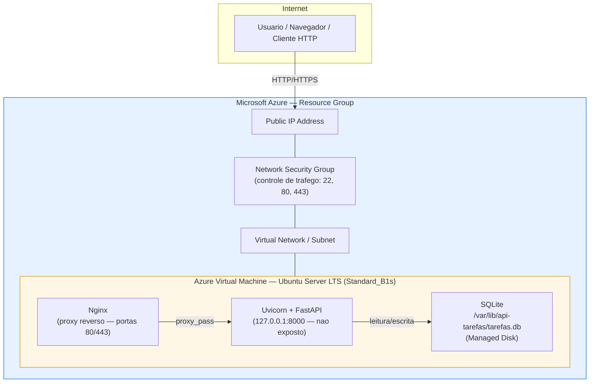

# Diagrama 1 — Arquitetura Azure

Representa a fronteira entre os recursos Azure (nuvem) e os componentes
internos da VM (sistema operacional). O NSG atua como controle de
trafego de rede (firewall), nunca como servidor de aplicacao.

**Observacoes:**
- O NSG controla quais portas podem receber trafego da internet (22 restrita ao IP do administrador; 80/443 liberadas; 8000 nunca exposta publicamente).
- O Managed Disk armazena o arquivo SQLite de forma persistente — ele nao e perdido ao reiniciar a VM, diferente do disco temporario local.
- O Uvicorn escuta somente em `127.0.0.1`, portanto so pode ser acessado pelo Nginx na mesma maquina.
