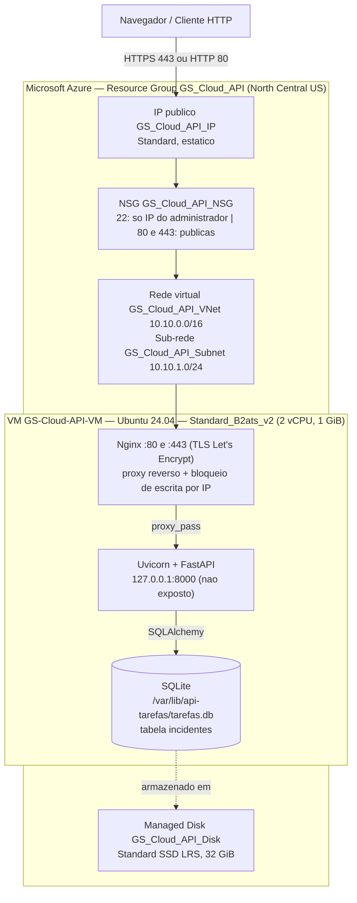

# Diagrama 1 — Arquitetura Azure da CyberIncident API

- O **NSG** funciona como firewall: SSH somente do IP do administrador, HTTP (80) e HTTPS (443) publicos; a porta 8000 nunca e liberada.
- O **Nginx** libera leitura (GET) para todos e restringe POST/PUT/PATCH/DELETE a IPs autorizados.
- O arquivo SQLite fica no **Managed Disk**, que persiste mesmo se a VM for reiniciada.
- O HTTPS usa certificado Let's Encrypt emitido para o IP (curta duracao, renovacao automatica por timer do systemd).
