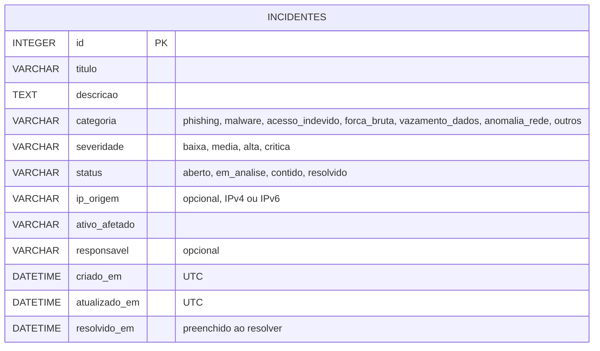

# Diagrama 3 — Modelo de dados SQLite: tabela `incidentes`

- Restricoes `CHECK` no banco garantem os valores validos de categoria, severidade e status.
- A tabela antiga `tarefas` (versao anterior do projeto) continua no mesmo arquivo, sem relacao com `incidentes` e sem alteracao.
