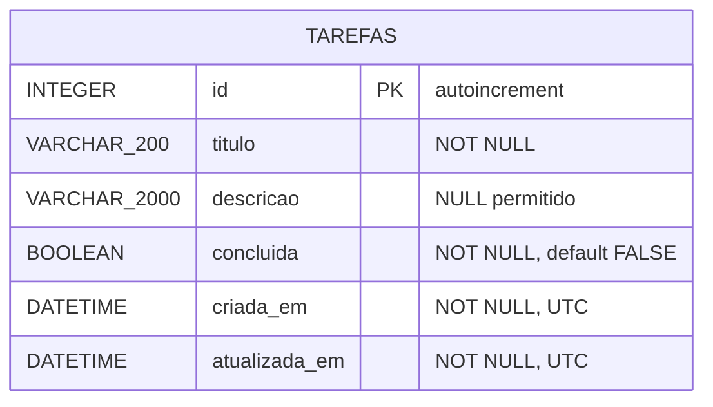

# Diagrama 3 — Modelo Entidade-Relacionamento

O projeto possui uma unica tabela, `tarefas`, sem relacionamentos com
outras tabelas (escopo academico pequeno e intencional).

**Restricoes e tipos:**

| Campo | Tipo SQL | Restricoes |
|---|---|---|
| id | INTEGER | Chave primaria, gerado automaticamente |
| titulo | VARCHAR(200) | Obrigatorio, 1 a 200 caracteres |
| descricao | VARCHAR(2000) | Opcional |
| concluida | BOOLEAN | Obrigatorio, padrao `false` |
| criada_em | DATETIME (UTC) | Obrigatorio, preenchido na criacao |
| atualizada_em | DATETIME (UTC) | Obrigatorio, atualizado em cada PUT |
