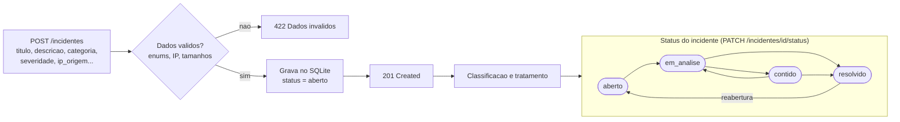

# Diagrama 4 — Cadastro e classificacao de incidentes

- Severidade: `baixa`, `media`, `alta`, `critica`. Categoria: phishing, malware, acesso_indevido, forca_bruta, vazamento_dados, anomalia_rede, outros.
- Ao **resolver**, `resolvido_em` recebe a data/hora UTC; ao **reabrir**, o campo e limpo.
- Transicoes fora do fluxo (ex.: `aberto` direto para `resolvido`) retornam HTTP 422.
