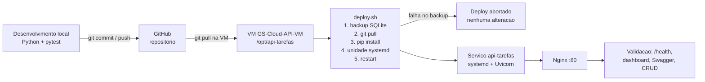

# Diagrama 5 — Fluxo de deploy: GitHub para Azure

- O banco **nao** e recriado: a migracao cria apenas a tabela `incidentes`, se ela nao existir.
- O `.env`, o arquivo do SQLite e a configuracao do Nginx da VM nao vao para o GitHub.
