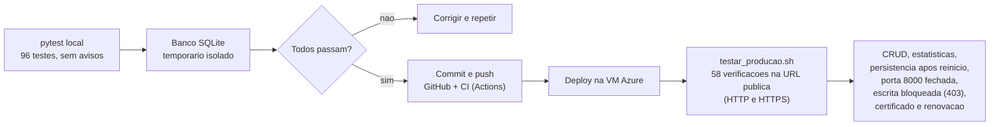

# Diagrama 6 — Fluxo de testes e validacao

- Testes locais: API, validacoes, migracao, persistencia, interface, seguranca (XSS, SQL injection, CORS) e configuracao do Nginx e do systemd.
- Testes em producao: executados contra o IP publico, com limpeza dos dados de teste.
